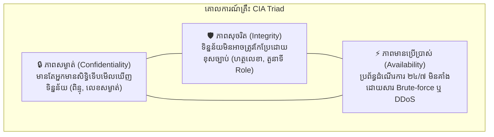
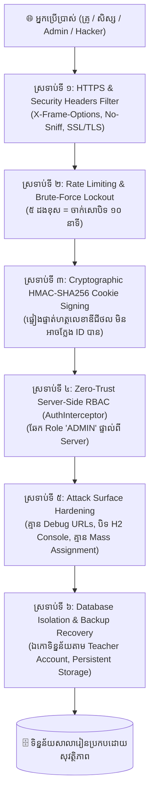
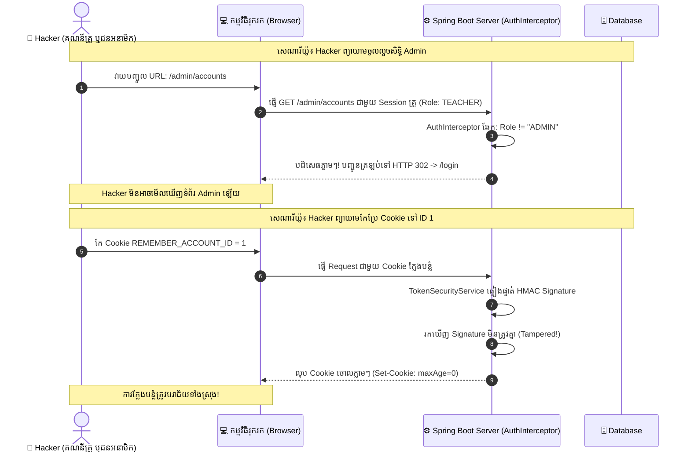

# មេរៀន និងឯកសារបច្ចេកទេស៖ ការការពារសុវត្ថិភាពប្រព័ន្ធគ្រប់គ្រងសាលារៀន
## (Web Application Security Architecture & Best Practices 2027)

> **ស្ថាប័ន / គម្រោង**: ប្រព័ន្ធគ្រប់គ្រងថ្នាក់រៀន ២០២៧ (Class Management System 2027)  
> **គោលបំណង**: ឯកសារមេរៀនយោងស្តីពីស្ថាបត្យកម្មសុវត្ថិភាព ការទប់ស្កាត់ការវាយប្រហារតាមអ៊ីនធឺណិត និងការគ្រប់គ្រងហានិភ័យ  
> **កម្រិតបច្ចេកវិទ្យា**: Spring Boot 3, Java 17, H2 Database, Cryptographic Security, Cloud Web Services  

---

## តារាងមាតិកា
1. [អារម្ភកថា និងទ្រឹស្តីគ្រឹះនៃសុវត្ថិភាពព័ត៌មាន (The CIA Triad)](#១-អារម្ភកថា-និងទ្រឹស្តីគ្រឹះនៃសុវត្ថិភាពព័ត៌មាន-the-cia-triad)
2. [ហានិភ័យទូទៅនៃការវាយប្រហារលើប្រព័ន្ធគេហទំព័រ (Common Cyber Threats)](#២-ហានិភ័យទូទៅនៃការវាយប្រហារលើប្រព័ន្ធគេហទំព័រ-common-cyber-threats)
3. [ស្ថាបត្យកម្មការពារ ៦ ស្រទាប់នៃប្រព័ន្ធ (The 6-Layer Security Architecture)](#៣-ស្ថាបត្យកម្មការពារ-៦-ស្រទាប់នៃប្រព័ន្ធ-the-6-layer-security-architecture)
   - [ស្រទាប់ទី ១៖ HTTP Security Headers & Network Transport](#ស្រទាប់ទី-១-http-security-headers--network-transport)
   - [ស្រទាប់ទី ២៖ ប្រព័ន្ធទប់ស្កាត់ការទាយពាក្យសម្ងាត់ (Rate Limiter)](#ស្រទាប់ទី-២-ប្រព័ន្ធទប់ស្កាត់ការទាយពាក្យសម្ងាត់-rate-limiter)
   - [ស្រទាប់ទី ៣៖ ការពារ Cookie ដោយហត្ថលេខាឌីជីថល (HMAC-SHA256 Signing)](#ស្រទាប់ទី-៣-ការពារ-cookie-ដោយហត្ថលេខាឌីជីថល-hmac-sha256-signing)
   - [ស្រទាប់ទី ៤៖ ការត្រួតពិនិត្យសិទ្ធិតាមម៉ាស៊ីនបម្រើ (Zero-Trust Server-Side RBAC)](#ស្រទាប់ទី-៤-ការត្រួតពិនិត្យសិទ្ធិតាមម៉ាស៊ីនបម្រើ-zero-trust-server-side-rbac)
   - [ស្រទាប់ទី ៥៖ ការកាត់បន្ថយផ្ទៃវាយប្រហារ (Attack Surface Hardening)](#ស្រទាប់ទី-៥-ការកាត់បន្ថយផ្ទៃវាយប្រហារ-attack-surface-hardening)
   - [ស្រទាប់ទី ៦៖ ការញែកដាច់ទិន្នន័យ និងការបម្រុងទុក (Data Isolation & Backup)](#ស្រទាប់ទី-៦-ការញែកដាច់ទិន្នន័យ-និងការបម្រុងទុក-data-isolation--backup)
4. [វិភាគករណីសិក្សាជាក់ស្តែង (Practical Attack Scenarios & Defenses)](#៤-វិភាគករណីសិក្សាជាក់ស្តែង-practical-attack-scenarios--defenses)
5. [បញ្ជីត្រួតពិនិត្យសម្រាប់អ្នកគ្រប់គ្រង (Admin Security Checklist)](#៥-បញ្ជីត្រួតពិនិត្យសម្រាប់អ្នកគ្រប់គ្រង-admin-security-checklist)
6. [វចនានុក្រមបច្ចេកទេសសុវត្ថិភាព (Security Glossary)](#៦-វចនានុក្រមបច្ចេកទេសសុវត្ថិភាព-security-glossary)

---

## ១. អារម្ភកថា និងទ្រឹស្តីគ្រឹះនៃសុវត្ថិភាពព័ត៌មាន (The CIA Triad)

នៅក្នុងវិស័យសន្តិសុខតាមប្រព័ន្ធអ៊ីនធឺណិត (Cybersecurity) គោលការណ៍គ្រឹះដែលមិនអាចខ្វះបានគឺ **CIA Triad**៖



1. **Confidentiality (ភាពសម្ងាត់)**: ពាក្យសម្ងាត់ ព័ត៌មានសិស្ស និងពិន្ទុ មិនត្រូវបានបង្ហាញជាសាធារណៈឡើយ។
2. **Integrity (ភាពសុចរិត និងត្រឹមត្រូវ)**: ពិន្ទុ វិញ្ញាបនបត្រ ត្រាសាលា និងតួនាទី (Role) មិនអាចត្រូវបានបន្លំ ឬកែប្រែដោយបុគ្គលគ្មានសិទ្ធិ។
3. **Availability (ភាពមានប្រើប្រាស់ជាប្រចាំ)**: ប្រព័ន្ធមិនត្រូវបានរំខាន ឬផ្អាកដំណើរការដោយសារការវាយប្រហារគាំង Server ឡើយ។

---

## ២. ហានិភ័យទូទៅនៃការវាយប្រហារលើប្រព័ន្ធគេហទំព័រ (Common Cyber Threats)

ខាងក្រោមនេះជាទម្រង់នៃការវាយប្រហារចម្បងៗដែលឧក្រិដ្ឋជនអ៊ីនធឺណិត (Hackers) តែងតែប្រើប្រាស់លើកម្មវិធីគ្រប់គ្រងសាលារៀន៖

| ឈ្មោះការវាយប្រហារ | និយមន័យ | គ្រោះថ្នាក់លើប្រព័ន្ធសាលា | ដំណោះស្រាយក្នុងប្រព័ន្ធយើង |
| :--- | :--- | :--- | :--- |
| **Broken Access Control (Privilege Escalation)** | ការជ្រៀតចូល ឬដំឡើងសិទ្ធិពីគ្រូធម្មតា ឬសិស្ស ឱ្យក្លាយជា Admin | Hacker អាចលុបគណនីទាំងអស់ កែប្រែពិន្ទុ ឬលុបទិន្នន័យចោល | ត្រួតពិនិត្យសិទ្ធិម៉ឺងម៉ាត់នៅកម្រិត Server ដោយ `AuthInterceptor` |
| **Brute-Force & Credential Stuffing** | ការប្រើកម្មវិធីស្វ័យប្រវត្តិដើម្បីទាយលេខសម្ងាត់រាប់ពាន់ដង | បែកធ្លាយគណនី Admin ឬគណនីគ្រូ ប្រសិនបើប្រើលេខងាយៗ | កំណត់ឱ្យទាយបានត្រឹម ៥ ដង រួចចាក់សោបិទ ១០ នាទី (`LoginRateLimiter`) |
| **Cookie Tampering / IDOR** | ការលួចកែតម្លៃ Cookie ផ្ទាល់ខ្លួន ទៅជា ID របស់អ្នកដទៃ | គ្រូម្នាក់អាចចូលមើល និងកែទិន្នន័យរបស់គ្រូម្នាក់ទៀត | ចុះហត្ថលេខាឌីជីថលលើ Cookie តាមក្បួន `HMAC-SHA256` |
| **Information Disclosure** | ការបែកធ្លាយទិន្នន័យតាមផ្លូវកាត់ (Debug URL ឬ DB Web Console) | Hacker មើលឃើញបញ្ជី Username/Password ទាំងអស់ | លុបចោល `/debug/accounts` និងបិទ H2 Database Web Console |
| **Clickjacking & MIME Sniffing** | ការបង្កប់គេហទំព័រក្នុង iFrame ដើម្បីបោកបញ្ឆោត ឬបន្លំឯកសារ | អ្នកប្រើប្រាស់ចុចច្រឡំ នាំឱ្យបាត់បង់ទិន្នន័យ ឬឆ្លងមេរោគ | បន្ថែម HTTP Security Headers (`X-Frame-Options: SAMEORIGIN`) |

---

## ៣. ស្ថាបត្យកម្មការពារ ៦ ស្រទាប់នៃប្រព័ន្ធ (The 6-Layer Security Architecture)



---

### ស្រទាប់ទី ១៖ HTTP Security Headers & Network Transport

ឯកសារកូដអនុវត្ត៖ [`SecurityHeadersFilter.java`](file:///D:/NUBB%20DOCUMENTARY/Class%20Management%20System2027/src/main/java/com/nubb/classroom/config/SecurityHeadersFilter.java)

រាល់ចរាចរណ៍ទិន្នន័យទាំងអស់ឆ្លងកាត់ Browser ត្រូវបានការពារដោយក្បាលកូដ (Headers) សុវត្ថិភាពស្តង់ដារអន្តរជាតិ៖
1. **X-Frame-Options: SAMEORIGIN**: ការពារកុំឱ្យគេហទំព័រដទៃអាចលួចទាញយកគេហទំព័រយើងទៅបង្កប់ក្នុង `<iframe>` របស់ពួកគេ ដើម្បីធ្វើការវាយប្រហារបន្លំចុច (Clickjacking)។
2. **X-Content-Type-Options: nosniff**: បង្ការកុំឱ្យ Browser ព្យាយាមទាយ ឬបកស្រាយប្រភេទឯកសារខុសពីអ្វីដែល Server បានកំណត់ (MIME-type Confusion Attack)។
3. **X-XSS-Protection: 1; mode=block**: បញ្ជាឱ្យ Browser បិទទំព័រភ្លាមៗ ប្រសិនបើរាវរកឃើញកូដ Cross-Site Scripting (XSS)។
4. **Referrer-Policy: strict-origin-when-cross-origin**: ការពារកុំឱ្យលេចធ្លាយ URL ខាងក្នុងនៃប្រព័ន្ធទៅកាន់គេហទំព័រខាងក្រៅ។
5. **Secure & HttpOnly Cookies**: Cookie ត្រូវបានកំណត់ទង់ `HttpOnly=true` (កូដ JavaScript ខាងក្រៅមិនអាចលួចអានបាន) និង `SameSite=Lax` (ការពារ Cross-Site Request Forgery - CSRF)។

---

### ស្រទាប់ទី ២៖ ប្រព័ន្ធទប់ស្កាត់ការទាយពាក្យសម្ងាត់ (Rate Limiter)

ឯកសារកូដអនុវត្ត៖ [`LoginRateLimiter.java`](file:///D:/NUBB%20DOCUMENTARY/Class%20Management%20System2027/src/main/java/com/nubb/classroom/config/LoginRateLimiter.java)

* **របៀបដំណើរការ**:
  - ប្រព័ន្ធកត់ត្រាចំនួនដងនៃការប៉ុនប៉ង Login បរាជ័យ (Failed Attempts) ផ្អែកលើអាសយដ្ឋាន IP របស់ឧបករណ៍ដែលផ្ញើមក។
  - ប្រសិនបើ Login ខុសចាប់ពី **៥ ដងជាប់គ្នា**៖
    $$\text{Failed Attempts} \ge 5 \implies \text{Lockout for } 10 \text{ minutes}$$
  - ក្នុងអំឡុងពេល ១០ នាទីនេះ រាល់ការប៉ុនប៉ង Login ទាំងអស់ពី IP នោះនឹងត្រូវ **ច្រានចោលភ្លាមៗ** ដោយមិនបាច់ទៅសួរ Database ឡើយ (ការពារកុំឱ្យ Database ធ្លាក់ចុះទម្ងន់)។

---

### ស្រទាប់ទី ៣៖ ការពារ Cookie ដោយហត្ថលេខាឌីជីថល (HMAC-SHA256 Signing)

ឯកសារកូដអនុវត្ត៖ [`TokenSecurityService.java`](file:///D:/NUBB%20DOCUMENTARY/Class%20Management%20System2027/src/main/java/com/nubb/classroom/config/TokenSecurityService.java)

* **បញ្ហាពីមុន (IDOR Vulnerability)**:
  - ប្រសិនបើ Cookie ផ្ទុកតម្លៃធម្មតា៖ `REMEMBER_ACCOUNT_ID=97`
  - Hacker អាចបើក Developer Tools រួចកែតម្លៃទៅជា `REMEMBER_ACCOUNT_ID=1` (ID របស់ Admin) នោះប្រព័ន្ធនឹងច្រឡំថា Hacker គឺជា Admin។

* **ដំណោះស្រាយបច្ចុប្បន្ន (HMAC-SHA256 Tokenization)**:
  - Cookie ត្រូវបានផ្លាស់ប្តូរទៅជាទម្រង់ Token ដែលមាន ២ ផ្នែក៖
    $$\text{Cookie Value} = \text{Base64}(\text{ID}) \mathbin{\Vert} \text{HMAC-SHA256}(\text{ID} \mathbin{\Vert} \text{AccountSecret}, \text{ServerSecret})$$
  - នៅពេលដែល Request មកដល់ Server នឹងគណនាហត្ថលេខាឡើងវិញដោយប្រើក្បួន `MessageDigest.isEqual` (Constant-Time Verification) ដើម្បីការពារ **Timing Attacks**។
  - ប្រសិនបើ Hacker ផ្លាស់ប្តូរលេខសម្គាល់ ID តែបន្តិច នោះហត្ថលេខានឹងខុសភ្លាម ហើយ Cookie ត្រូវបានលុបចោលជាបន្ទាន់!

---

### ស្រទាប់ទី ៤៖ ការត្រួតពិនិត្យសិទ្ធិតាមម៉ាស៊ីនបម្រើ (Zero-Trust Server-Side RBAC)

ឯកសារកូដអនុវត្ត៖ [`AuthInterceptor.java`](file:///D:/NUBB%20DOCUMENTARY/Class%20Management%20System2027/src/main/java/com/nubb/classroom/config/AuthInterceptor.java)

* **គោលការណ៍ Zero Trust**: កុំជឿទុកចិត្តអ្វីទាំងអស់ដែលចេញពី Browser របស់ User។ គ្រប់ Request ត្រូវតែឆ្លងកាត់ការឆែកសិទ្ធិ Role នៅលើ Server ជាមុនសិន។
* **យន្តការអនុវត្ត**:
  ```java
  // 1. ផ្លូវ Admin ទាំងអស់ទាមទារសិទ្ធិ ADMIN ដាច់ខាត
  if (path.startsWith("/admin")) {
      String role = (String) session.getAttribute("ACCOUNT_ROLE");
      if (role == null || !"ADMIN".equals(role)) {
          response.sendRedirect("/login");
          return false;
      }
      return true;
  }
  ```
* **ការការពារ Parameter Tampering / Mass Assignment**:
  - នៅក្នុងទម្រង់កែប្រែ Profile របស់គ្រូ គ្មាន Parameter `role` ត្រូវបានអនុញ្ញាតឱ្យទទួលយកឡើយ។
  - មានតែ Admin ដែល Login ស្របច្បាប់ប៉ុណ្ណោះ ទើបអាចហៅ Method `acc.setRole(...)` នៅក្នុង [`AdminController.java`](file:///D:/NUBB%20DOCUMENTARY/Class%20Management%20System2027/src/main/java/com/nubb/classroom/controller/AdminController.java) បាន។

---

### ស្រទាប់ទី ៥៖ ការកាត់បន្ថយផ្ទៃវាយប្រហារ (Attack Surface Hardening)

* **លុបបំបាត់ Debug Endpoints**: បានដកចេញទាំងស្រុងនូវ `@GetMapping("/debug/accounts")` ដែលកាលពីមុនធ្លាប់បង្ហាញបញ្ជី Username និង Password ទាំងអស់។
* **បិទផ្លូវ H2 Database Web Console**:
  - នៅក្នុង `application.properties`: កំណត់ `spring.h2.console.enabled=false`
  - នៅក្នុង `AuthInterceptor.java` និង `SecurityHeadersFilter.java`: ដាក់រនាំងរារាំងផ្លូវ `/h2-console/**` ជាដាច់ខាត (HTTP 403 Forbidden)។
* **ភាពឯកោនៃហត្ថលេខា និងត្រា (Signature Isolation)**:
  - កែសម្រួល [`CertificateController.java`](file:///D:/NUBB%20DOCUMENTARY/Class%20Management%20System2027/src/main/java/com/nubb/classroom/controller/CertificateController.java) ដើម្បីកុំឱ្យគ្រូម្នាក់អាចផ្ទុកឡើង (Upload) ហត្ថលេខា ឬត្រាដែលជាន់លើគណនី Admin ឬគណនីគ្រូផ្សេងទៀត។

---

### ស្រទាប់ទី ៦៖ ការញែកដាច់ទិន្នន័យ និងការបម្រុងទុក (Data Isolation & Backup)

* **ភាពឯកោរវាងគណនីគ្រូនីមួយៗ (Per-Teacher Workspace)**:
  - ថ្នាក់រៀន បញ្ជីសិស្ស តារាងពិន្ទុ និងកាលវិភាគ ត្រូវបានភ្ជាប់ជាមួយ `accountId` ផ្ទាល់ខ្លួនរបស់គ្រូម្នាក់ៗ។
  - គ្រូ A មិនអាចមើលឃើញ ឬកែប្រែពិន្ទុ និងថ្នាក់របស់គ្រូ B បានឡើយ។
* **ការការពារទិន្នន័យលើ Cloud**:
  - Database ដំណើរការជាលក្ខណៈ File-based Persistent Database (`./data/classroomDB`)។
  - នៅពេលដាក់ឱ្យដំណើរការលើ Render (Starter Plan) ទិន្នន័យត្រូវបានរក្សាទុកជាប់លាប់ និងអាចទាញយក Backup ជាឯកសារ SQL (`data_dump.sql`) ទុកគ្រប់ពេលវេលា។

---

## ៤. វិភាគករណីសិក្សាជាក់ស្តែង (Practical Attack Scenarios & Defenses)



---

## ៥. បញ្ជីត្រួតពិនិត្យសម្រាប់អ្នកគ្រប់គ្រង (Admin Security Checklist)

ដើម្បីរក្សាសុវត្ថិភាពឱ្យនៅកម្រិតអតិបរមាជានិច្ច អ្នកគ្រប់គ្រងប្រព័ន្ធ (Admin) គប្បីអនុវត្តតាមវិធានការណ៍ដូចខាងក្រោម៖

- [ ] **ផ្លាស់ប្តូរពាក្យសម្ងាត់ដើម (Default Password)**:
  - ហាមដាច់ខាតមិនឱ្យប្រើ `admin / admin123` ឡើយ។
  - ចូលទៅកាន់ `/admin/accounts` ហើយផ្លាស់ប្តូរ Username និង Password របស់ Admin ឱ្យមានប្រវែងយ៉ាងតិច ១២ ខ្ទង់ រួមបញ្ចូលអក្សរធំ តូច លេខ និងសញ្ញាពិសេស (ឧទាហរណ៍៖ `Admin@Nubb2027#Secure!`)។
- [ ] **ពិនិត្យស្ថានភាពគណនីគ្រូ (Active / Inactive Status)**:
  - ប្រសិនបើមានគ្រូផ្លាស់ប្តូរសាលា ឬឈប់បង្រៀន Admin គ្រាន់តែចុចបិទដំណើរការ (Disable Account) ក្នុងទំព័រ `/admin/accounts` នោះគណនីនោះនឹងមិនអាច Login ឬដំណើរការអ្វីបានឡើយ។
- [ ] **ការបម្រុងទុកទិន្នន័យ (Regular Backups)**:
  - គប្បីទាញយកទិន្នន័យបម្រុងទុក (Export Data / SQL Dump) ជារៀងរាល់ដំណាច់ខែ ឬដំណាច់ឆមាស ទុកលើ External Hard Drive ឬ Google Drive ផ្ទាល់ខ្លួន។
- [ ] **រក្សាការសម្ងាត់នៃលេខទូរស័ព្ទ និងគណនី Telegram**:
  - បណ្តុះបណ្តាលលោកគ្រូ-អ្នកគ្រូ មិនឱ្យចែករំលែកលេខសម្ងាត់ផ្ទាល់ខ្លួនទៅឱ្យអ្នកដទៃ ឬកត់ទុកលើក្រដាសនៅទីសាធារណៈ។

---

## ៦. វចនានុក្រមបច្ចេកទេសសុវត្ថិភាព (Security Glossary)

| ពាក្យបច្ចេកទេស (English) | បកប្រែជាភាសាខ្មែរ | ការពន្យល់សង្ខេប |
| :--- | :--- | :--- |
| **Authentication (AuthN)** | ការផ្ទៀងផ្ទាត់អត្តសញ្ញាណ | ការបញ្ជាក់ថា "តើអ្នកជានរណា?" តាមរយៈ Username និង Password |
| **Authorization (AuthZ)** | ការអនុញ្ញាតសិទ្ធិ | ការបញ្ជាក់ថា "តើអ្នកមានសិទ្ធិធ្វើអ្វីខ្លះ?" ដូចជា ADMIN ឬ TEACHER |
| **Brute-Force Attack** | ការវាយប្រហារសាកទាយពាក្យសម្ងាត់ | ការប្រើប្រាស់កុំព្យូទ័រទាយពាក្យសម្ងាត់ម្តងមួយៗរហូតដល់ត្រូវ |
| **Rate Limiting** | ការកម្រិតចំនួនដងនៃការស្នើសុំ | ការកំណត់ឱ្យ User ឬ Bot អាច Login បានត្រឹមចំនួនដងកំណត់មួយ |
| **HMAC-SHA256** | ក្បួនគណនាហត្ថលេខាឌីជីថលសម្ងាត់ | ក្បួនគណិតវិទ្យាសម្ងាត់ ដើម្បីធានាថាទិន្នន័យ Cookie មិនត្រូវបានគេលួចកែ |
| **IDOR** | ការយោងវត្ថុដោយផ្ទាល់គ្មានសុវត្ថិភាព | ភាពងាយរងគ្រោះដែល Hacker អាចប្តូរលេខសម្គាល់ ID ដើម្បីលួចទិន្នន័យអ្នកដទៃ |
| **RBAC** | ការគ្រប់គ្រងសិទ្ធិតាមតួនាទី | Role-Based Access Control (ការកំណត់សិទ្ធិដាច់ដោយឡែករវាងគ្រូ និង Admin) |
| **Zero Trust** | គោលការណ៍ "មិនទុកចិត្តអ្វីទាំងអស់" | យុទ្ធសាស្ត្រសុវត្ថិភាពដែលតម្រូវឱ្យ Server ត្រួតពិនិត្យសិទ្ធិគ្រប់ពេលវេលា |

---
*ឯកសារនេះត្រូវបានរៀបចំឡើងជាពិសេសសម្រាប់គម្រោង **ប្រព័ន្ធគ្រប់គ្រងថ្នាក់រៀន ២០២៧** ទុកជាឯកសារយោង និងជាមេរៀនបច្ចេកទេស។*
